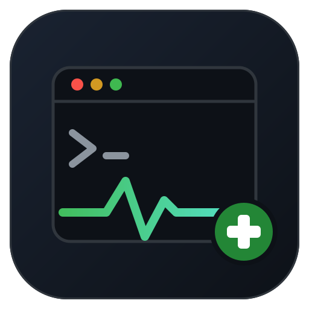
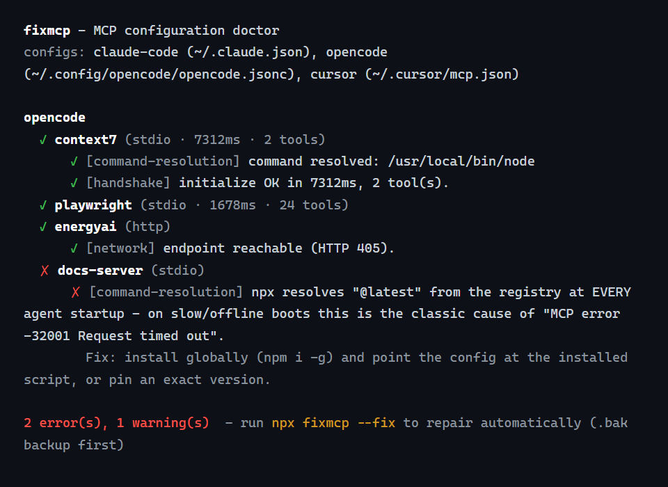
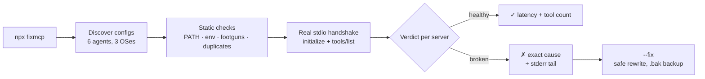

<div align="center">



# fixmcp

### Stop guessing which MCP server is broken. Ask the doctor.

[](https://github.com/Ayoola-tech2024/fixmcp/actions/workflows/ci.yml)
[](https://www.npmjs.com/package/fixmcp)
[](https://www.npmjs.com/package/fixmcp)
[](https://www.npmjs.com/package/fixmcp)
[](./LICENSE)

<a href="https://www.npmjs.com/package/fixmcp">

</a>

```bash
npx fixmcp
```

**One command.** Finds every MCP config on your machine — Claude Code, Claude Desktop,
opencode, Cursor, VS Code, Codex CLI — handshakes every server *for real*, and tells you
exactly what's broken and how to fix it.

Windows · macOS · Linux — zero install — nothing leaves your machine.



</div>

---

## Why do my MCP servers fail with `-32001: Request timed out`?

```
MCP error -32001: Request timed out
```

No server name. No cause. Your tools silently missing, or the whole agent hung at startup.

fixmcp was born from exactly this: four servers failing on *every* boot because their configs
used `npx -y <pkg>@latest` — an npm registry round-trip at every single launch, dead on slow
networks. Diagnosing took an afternoon. Fixing took minutes. This tool collapses that
afternoon into one command.

## How it works



Most tools lint your config. **fixmcp spawns every stdio server and runs the same JSON-RPC
conversation your agent runs at startup.** What it reports matches what actually happens —
including per-server latency and discovered tool counts.

## What it checks

| Check | stdio | http/sse | Catches |
|---|:-:|:-:|---|
| **command-resolution** | ✓ | | Commands not on PATH, missing node scripts, unpinned `npx pkg@latest` registry round-trips |
| **handshake** | ✓ | | Servers that spawn but never answer `initialize`; per-server latency + tool count |
| **network** | | ✓ | Unreachable endpoints (DNS, refused, timeout) with the OS error code |
| **env-check** | ✓ | ✓ | `${VAR}` references to variables not set on your machine |
| **patterns** | ✓ | ✓ | `npx` without `-y` (interactive-prompt hang), Claude Desktop silently ignoring `timeout` ([#43791](https://github.com/anthropics/claude-code/issues/43791)) |
| **duplicates** | ✓ | ✓ | The same server name defined across multiple agents |

## Which agents does fixmcp support?

| Agent | Config file | Auto-fix |
|---|---|:-:|
| Claude Code | `~/.claude.json` | ✓ |
| Claude Desktop | `%APPDATA%\Claude\claude_desktop_config.json` | ✓ |
| Cursor | `~/.cursor/mcp.json` | ✓ |
| VS Code | `%APPDATA%\Code\User\mcp.json` | ✓ |
| opencode | `~/.config/opencode/opencode.jsonc` | report-only* |
| Codex CLI | `~/.codex/config.toml` | report-only* |

\* Comment-bearing formats (JSONC/TOML) would lose their comments in a naive rewrite, so
fixmcp prints exact manual instructions instead of mangling them.

Windows is first-class: `.cmd`/`.bat` commands route through `cmd.exe` (Node ≥ 20 refuses to
spawn them directly), PATH lookup honors `PATHEXT`, and child trees are cleaned via `taskkill /T`.

## How fixmcp compares

| Capability | `fixmcp` | Official MCP Inspector | Static Config Linters |
|---|:-:|:-:|:-:|
| Auto-discovers all 6 agent configs (`Claude Code`, `Claude Desktop`, `Cursor`, `VS Code`, `opencode`, `Codex CLI`) | ✓ | Manual per server | Partial |
| Real stdio JSON-RPC `initialize` + `tools/list` handshakes with latency & `stderr` tail | ✓ | Interactive UI | ✗ |
| Detects & auto-fixes `npx @latest` `-32001` startup timeouts with `.bak` backups | ✓ | ✗ | Partial |
| Machine-readable `--json` + exit codes (`0`/`1`/`2`) for CI & coding agents | ✓ | ✗ | Varies |
| Runs offline against local configs with zero account or browser required | ✓ | Browser UI | ✓ |

## How do I fix a broken MCP server config? (`--fix`)

The footgun this tool exists for:

```json
"context7": { "command": "npx", "args": ["-y", "@upstash/context7-mcp@latest"] }
```

`@latest` = npm hits the registry on **every agent startup**. Slow boot network → 90s timeout
→ `-32001`. `npx fixmcp --fix` rewrites it to the already-installed script:

```json
"context7": {
  "command": "C:\\Program Files\\nodejs\\node.exe",
  "args": ["C:\\Users\\you\\AppData\\Roaming\\npm\\node_modules\\@upstash\\context7-mcp\\dist\\index.js"]
}
```

Zero network at startup. Millisecond launches. Safety rails:

- `<file>.fixmcp.bak` backup written before any change
- Only plain-JSON agents are rewritten; never downloads anything; skips packages not installed
- Re-run `fixmcp` afterwards to verify

Trade-off: updating a server afterwards means `npm i -g <pkg>` — one deliberate update beats
gambling on the registry every boot.

## Built for humans *and* agents (Dual-Mode: MCP Server + CLI Doctor)

`fixmcp` runs both as a **stdio MCP server** (so your AI agent can self-diagnose and repair its own MCP environment via MCP tools, resources, and prompts) and as a **zero-install CLI doctor**.

### 1. Run as an MCP Server (`fixmcp serve`)

Add `fixmcp` to your `claude_desktop_config.json`, `~/.cursor/mcp.json`, or `~/.claude.json`:

```json
{
  "mcpServers": {
    "fixmcp": {
      "command": "npx",
      "args": ["-y", "fixmcp", "serve"]
    }
  }
}
```

#### Exposed MCP Tools (`tools/list`)

| Tool | Description |
|---|---|
| `diagnose_mcp_configs` | Discover and scan all local agent MCP config files (`Claude Code`, `Claude Desktop`, `Cursor`, `VS Code`, `opencode`, `Codex CLI`), running static checks and live stdio JSON-RPC handshakes. |
| `test_mcp_server` | Spawn any target stdio MCP server command (or probe an HTTP/SSE endpoint) and perform a real `initialize` + `tools/list` handshake with latency and `stderr` diagnostics. |
| `repair_mcp_configs` | Compute or apply safe rewrites for fragile `npx -y <pkg>@latest` entries to direct cached Node script paths (with `.fixmcp.bak` backups). |
| `list_agent_config_paths` | Return all supported AI coding agents and their expected MCP config file paths on the current OS. |

#### Exposed MCP Resources & Prompts

- **Resource (`fixmcp://agents/supported`)**: JSON specification of all supported agent configuration targets and formats.
- **Prompt (`troubleshoot-mcp-timeout`)**: Guided diagnostic workflow for resolving `MCP error -32001: Request timed out`.

### 2. Run as a CLI Doctor (`npx fixmcp`)

Exit codes (`0` healthy · `1` errors · `2` internal) + `--json` mode mean your coding agent
can also drive it from the terminal. Add this to your project's `AGENTS.md`:

```markdown
When the user reports MCP server errors or timeouts, run:
  npx fixmcp --json
Read findings[].message/detail for exact causes. Apply config fixes with:
  npx fixmcp --fix
Then re-run without flags to verify.
```

## FAQ

<details>
<summary><b>What does <code>MCP error -32001: Request timed out</code> mean?</b></summary>

It's the generic MCP error your agent shows when a server doesn't answer the
<code>initialize</code> handshake in time. It never names the server or the cause — common
reasons include <code>npx pkg@latest</code> configs forcing a registry round-trip at startup,
commands not on PATH, missing env vars, or servers that crash on launch. <code>npx fixmcp</code>
tells you which server and exactly why.
</details>

<details>
<summary><b>Does fixmcp send my config anywhere?</b></summary>

No. Everything runs locally. Nothing is uploaded, ever.
</details>

<details>
<summary><b>Will it modify anything without asking?</b></summary>

It only writes files with <code>--fix</code>, always after a <code>.bak</code> backup, and only
plain-JSON configs. Without <code>--fix</code> it is strictly read-only.
</details>

<details>
<summary><b>My server needs env vars/auth to start - will the handshake fail?</b></summary>

Possibly, and that's useful: if a server exits due to missing credentials, fixmcp shows its
stderr tail as the failure detail so you see the real cause instead of a bare timeout.
</details>

<details>
<summary><b>How long does a scan take?</b></summary>

A few seconds per stdio server (that's a real process launch + handshake). Tune with
<code>--timeout &lt;ms&gt;</code>, or use <code>--no-handshake</code> for instant static-only checks.
</details>

## Development

```bash
git clone https://github.com/Ayoola-tech2024/fixmcp
cd fixmcp && npm install
npm test        # build + full suite, including real stdio handshake tests
node bin/fixmcp.js --help
```

Node ≥ 20 · TypeScript strict · runtime deps: `jsonc-parser` + `smol-toml`, nothing else.
Tested on Ubuntu, Windows and macOS across Node 20 and 22.

Contributions welcome — open an issue before large changes. Especially wanted: more agent
config formats, more real-world footgun patterns, macOS/Linux path testing.

## License

[MIT](./LICENSE) © [Ayoola Damisile](https://github.com/Ayoola-tech2024)

<div align="center">

**If fixmcp saved you a debugging session, leave a star — it helps the next person find it.**

`npx fixmcp`

</div>
